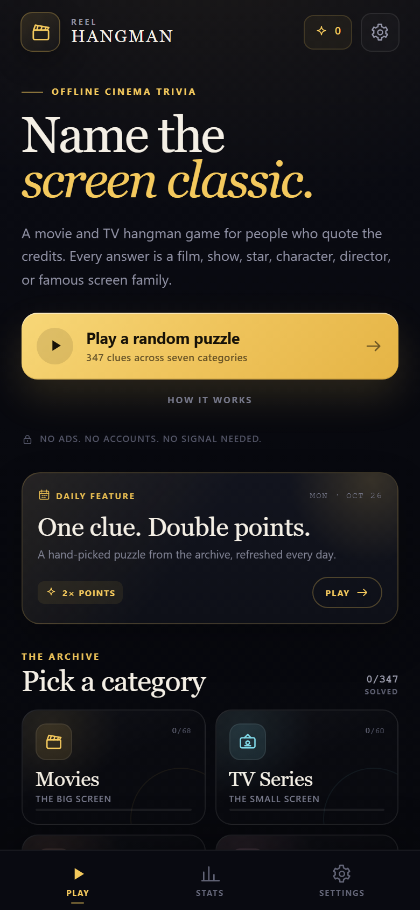
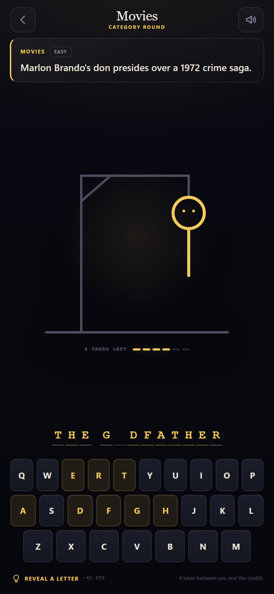
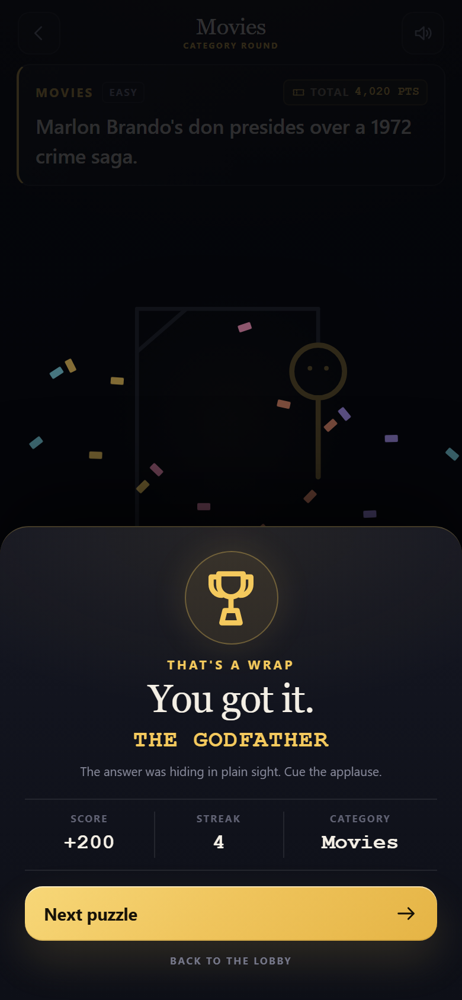
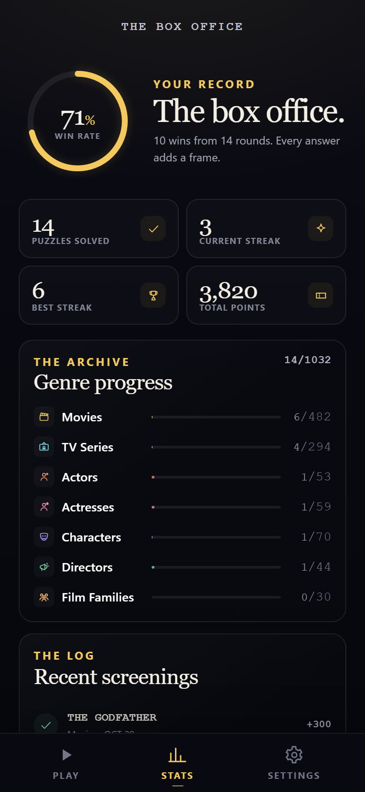
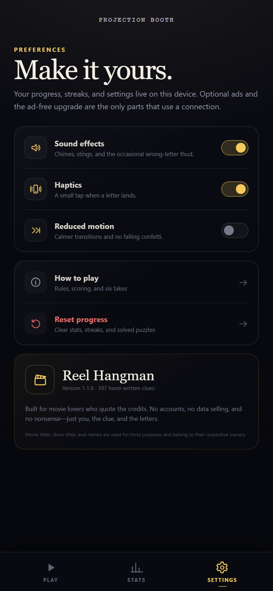
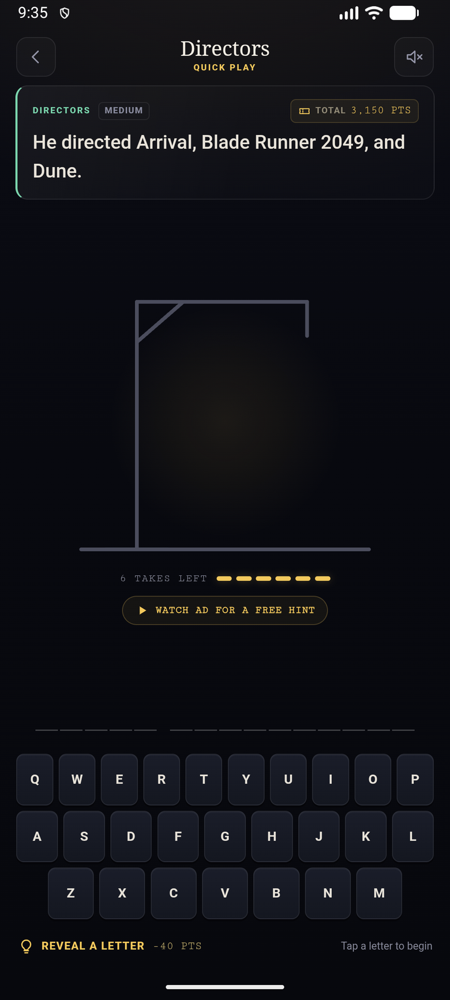
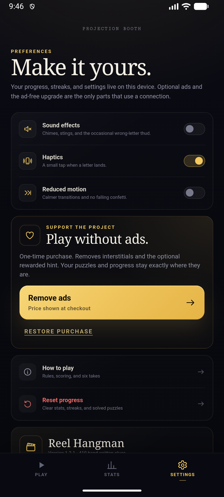

# Reel Hangman

**An offline-first movie & TV hangman game for Android and iOS.**

Name the film, show, star, character, director, or famous screen family before the credits roll. No accounts. Optional ads. The puzzles play offline.



## What is inside

- **976 hand-written puzzles** across seven categories:
  - Movies — 514
  - TV Series — 206
  - Actors — 53
  - Actresses — 59
  - Characters — 70
  - Directors — 44
  - Film Families — 30
- **A proper hangman round** with six takes, an animated gallows, large readable clues, on-screen and physical keyboards, and punctuation-friendly answers.
- **Replay on a miss** — when you run out of takes, the failed question stays on screen with the answer hidden, and **Replay this puzzle** resets the same board; the next question is never loaded automatically.
- **A hand-written clue** for every answer.
- **Daily Feature** — one date-seeded puzzle per day, worth double points.
- **Repeatable hints** — each one reveals a useful missing letter and requires at least 40 total points, deducted immediately; hints never cost a take.
- **Optional rewarded video** — watch an ad for a free hint without spending points.
- **Capped interstitial** — only after a win, at most once every 3 completed rounds and 90 seconds; never after a loss or replay.
- **One-time Remove Ads purchase** — disables interstitials and the rewarded hint, with restore-purchase support.
- **Progress that stays put** — solved puzzles, category completion, win rate, current and best streak, total points, recent history, and an in-progress round survive an app restart.
- **Accessible by design** — semantic buttons, focus rings, dialog focus trapping, a polite live region for game events, reduced-motion support, and keyboard controls.
- **Native-feeling details** — generated app icon and splash screen, status-bar styling, light haptics, synthesized sound effects, and the Android back button.
- **Offline-first** — all puzzles, artwork, audio, and code ship inside the app. The game, hints, stats, and replay work without a signal. Ads, consent forms, and purchase restore need a connection; if they are unavailable, gameplay continues normally.

| Game | Win screen |
| --- | --- |
|  |  |

| Stats | Settings |
| --- | --- |
|  |  |

| Rewarded hint (native) | Remove Ads (native) |
| --- | --- |
|  |  |

The web/PWA build has no ad UI. Ads and the Remove Ads purchase are available only in the Android and iOS builds.

## Play the Android build

A debug-signed, installable APK is included:

```text
release/ReelHangman-1.2.9-debug.apk
```

```bash
adb install -r release/ReelHangman-1.2.9-debug.apk
```

This is a **testing build**, not a Play Store upload. See [signing a release](#signing-for-the-stores) below.

The iOS project is complete in [`ios/`](ios/), but iOS builds require macOS and Xcode. There is no way to compile or codesign an iOS app on Windows.

## Quick start (web / PWA)

Requirements: Node.js 22+ and npm.

```bash
npm ci
npm run dev
```

Open the URL printed by Vite. For a production build:

```bash
npm run build
npm run preview
```

The production build also generates an offline service worker and precaches the app shell, so the web version can be installed as a PWA and opened offline after the first visit.

## Build Android

Requirements:

- JDK **21** (Capacitor 8 / Gradle 8.14 does not support JDK 25)
- Android SDK **platform 36** and **build tools 36**
- `ANDROID_HOME` or `ANDROID_SDK_ROOT` pointing at the SDK
- `android/local.properties` containing:
  ```properties
  sdk.dir=C:/Users/you/AppData/Local/Android/Sdk
  ```

```bash
npm run build
npx cap sync android
cd android
./gradlew assembleDebug
```

Windows:

```powershell
$env:JAVA_HOME = "C:\path\to\jdk-21"
cd android
.\gradlew.bat assembleDebug
```

The APK is written to `android/app/build/outputs/apk/debug/app-debug.apk`.

To open the native project in Android Studio:

```bash
npx cap open android
```

## Build iOS

Requirements: macOS, Xcode 16+, an Apple developer team, and a device or simulator.

```bash
npm ci
npm run build
npx cap sync ios
npx cap open ios
```

In Xcode:

1. Select the `App` target.
2. Choose your team under **Signing & Capabilities**.
3. Change the bundle identifier if `com.reelhangman.game` is already taken.
4. Select a simulator or device and run, or use **Product → Archive** for TestFlight.

Capacitor 8 uses Swift Package Manager for its iOS plugins, so CocoaPods is not required.

The iOS project is configured for iPhone, portrait orientation, iOS 15+, dark appearance, a generated 1024×1024 app icon and launch image, and the In-App Purchase capability.

## Ads, consent, and purchases

Reel Hangman includes:

- Google AdMob rewarded video (optional free hint)
- Google AdMob interstitial, capped to one per 3 completed rounds and 90 seconds
- A one-time Remove Ads purchase via Google Play Billing / StoreKit 2

The Android AdMob app ID and both Android ad unit IDs are configured. The debug build keeps `VITE_ADMOB_USE_TEST=true`, so it requests test ads and cannot earn revenue. Set it to `false` for a release build. iOS still uses Google test IDs until the iOS AdMob app and units are configured. A new AdMob account may return “Account not approved yet” until Google completes account verification; ads will not fill until then.

Full setup instructions: [docs/ADS_SETUP.md](docs/ADS_SETUP.md).

The ad-free product ID is:

```text
com.reelhangman.game.removeads
```

The current debug APK uses test ads; it is not a production monetization build. A release build also requires the Remove Ads product, UMP messages, and store-signed testing.

## Project layout

```text
reel-hangman/
├─ src/
│  ├─ data/              # 976 puzzles, split by category
│  ├─ config/ads.ts      # AdMob IDs, caps, Remove Ads product
│  ├─ core/game.ts       # pure game rules, scoring, daily seeding
│  ├─ core/storage.ts    # versioned localStorage persistence
│  ├─ core/ads.ts        # AdMob, UMP/ATT, purchases, offline fallback
│  ├─ core/audio.ts      # Web Audio sound synthesis (no audio files)
│  ├─ core/platform.ts   # Capacitor status bar, haptics, splash
│  ├─ ui/app.ts          # screens, rendering, input handling
│  ├─ ui/icons.ts        # inline SVG icon set
│  └─ styles.css         # cinematic mobile-first styling
├─ public/               # PWA manifest, icons, service-worker source dir
├─ resources/            # source icon and splash images
├─ scripts/              # content validation, PWA build, asset generation, browser tests
├─ android/              # Capacitor Android project
├─ ios/                  # Capacitor iOS project
├─ docs/                 # screenshots, ad setup, store checklist, privacy policy
└─ release/              # installable APK
```

## Content and design

Puzzles live in `src/data/movies.ts`, `tv.ts`, `actors.ts`, `actresses.ts`, `characters.ts`, `directors.ts`, and `families.ts`.

```ts
movie(
  "THE GODFATHER",
  "Marlon Brando's don presides over a 1972 crime saga.",
  "It won Best Picture and earned Brando his second Oscar, which he refused in protest.",
  1, // 1 easy, 2 medium, 3 hard
);
```

Rules:

- Answers are uppercase letters and normal punctuation. Players only guess A–Z; spaces and punctuation are displayed automatically.
- Puzzle IDs are generated from the category and answer, so avoid duplicate answers unless you intentionally want two versions in different categories.
- Run `npm run validate:data` to check for duplicate IDs/answers, unsupported characters, short clues, and long answers.
- Keep clues useful but don't put the full answer in the clue.

The interface uses only system fonts and hand-authored CSS/SVG. There are no remote fonts or image packs. The native builds make network calls only for ads, consent, and purchase restore.

## Testing

The repository includes two Chrome DevTools Protocol test scripts:

```bash
# With a preview server on http://127.0.0.1:4173 and headless Chrome
# started with --remote-debugging-port=9333:
node scripts/browser-check.mjs   # responsive screenshots + layout checks
node scripts/game-test.mjs       # gameplay, persistence, daily, reset, keyboard, 320px checks
```

`npm run validate:data` is also part of `npm run build`.

## Signing for the stores

### Android

Create a private keystore **outside this repository**:

```bash
keytool -genkeypair -v -keystore reel-hangman-release.jks \
  -alias reelhangman -keyalg RSA -keysize 2048 -validity 10000
```

Add a `signingConfigs.release` block to `android/app/build.gradle` using environment variables or a local `keystore.properties` file, then:

```bash
cd android
./gradlew bundleRelease
```

Upload `android/app/build/outputs/bundle/release/app-release.aab` to Google Play. Keep the keystore and passwords backed up; losing them prevents updates.

### iOS

Use Xcode **Product → Archive**, then distribute through the Organizer to TestFlight/App Store Connect. You need an App Store Connect app record and provisioning.

Before shipping, change `com.reelhangman.game` to a bundle ID you control in both `capacitor.config.ts` and the native projects, update the version, and replace the placeholder developer details in the privacy policy.

See [docs/STORE_CHECKLIST.md](docs/STORE_CHECKLIST.md) for a pre-flight list.

## Privacy

Progress and settings are stored locally on the device. The Android and iOS builds use Google AdMob for optional ads and Google Play Billing / StoreKit for the Remove Ads purchase; those services may process device identifiers, approximate location, ad interactions, and purchase confirmation data. Consent is requested through Google UMP, and iOS ATT permission is requested before tracking-based ads. The app requests `VIBRATE`, `INTERNET`, `ACCESS_NETWORK_STATE`, and Android `BILLING`. See [docs/PRIVACY.md](docs/PRIVACY.md).

## License

Code is released under the MIT License. See [LICENSE](LICENSE).

Movie titles, series titles, characters, and people's names are used for trivia and identification. They remain the property of their respective owners. This is an independent fan-made game and is not affiliated with any studio, network, or streaming service.
